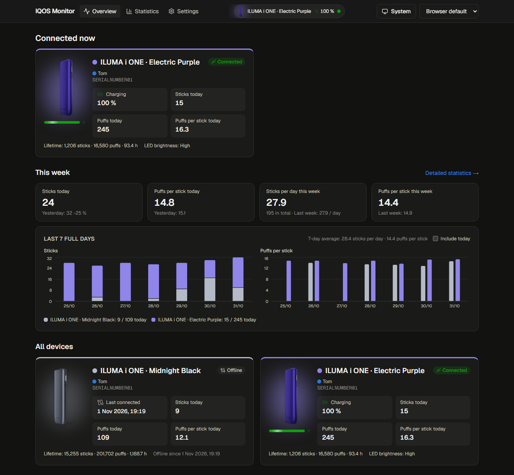
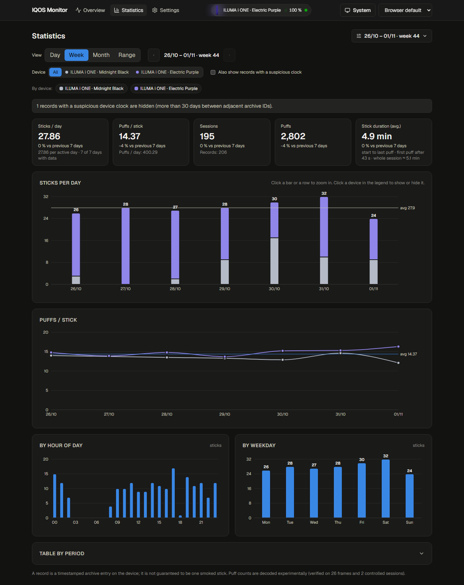
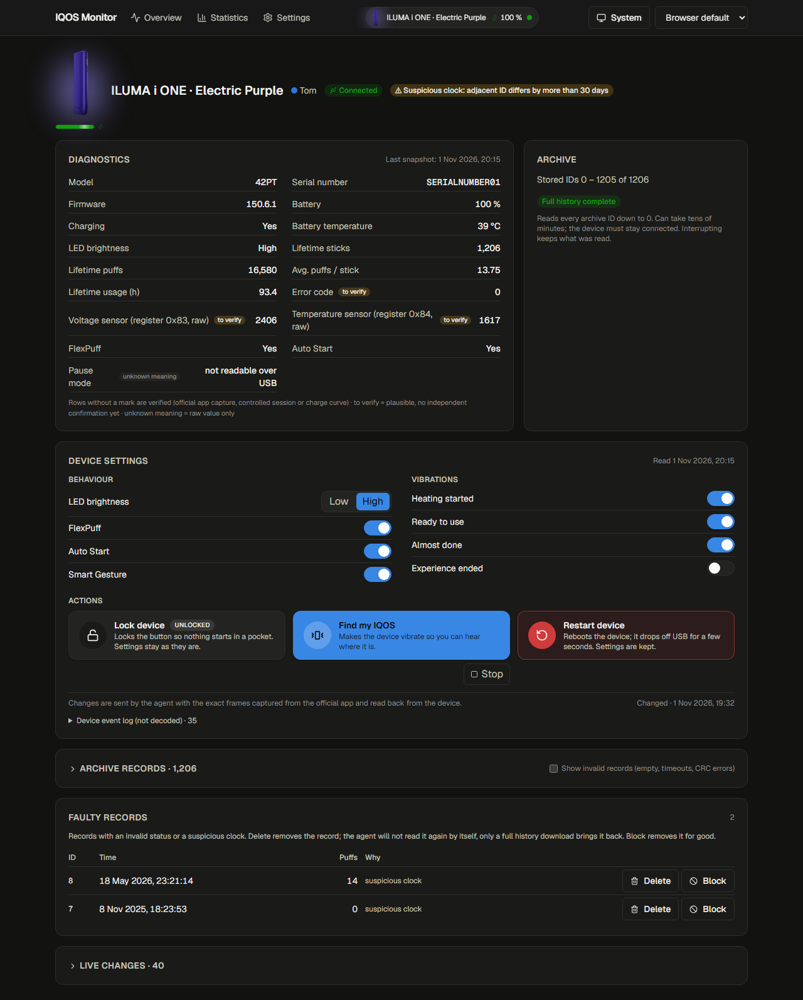
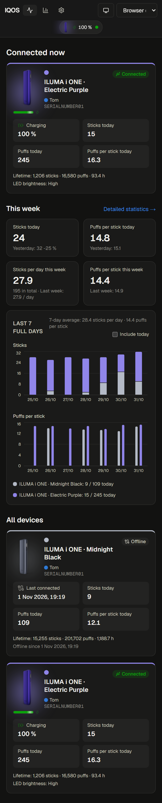

# IQOS Monitor

Self-hosted usage statistics and live status for IQOS ILUMA i ONE devices.
A small Windows tray agent reads the device over USB, a web app on your own
server keeps the history and shows it: sticks per day, puffs per stick, how
long a stick lasts, when during the day you smoke, battery and charging live,
and the device settings the official app offers, all without a cloud account.

Everything stays on your network. There is no login; people are simple
profiles that group devices.



## What it does

- **Overview for one person**: connected devices with live battery, today's
  sticks and puffs, "this week" at a glance and the last seven full days.
- **Statistics** by day (hour by hour), week or month with arrows to page
  through time, or any date range with the usual presets. Sticks per day,
  puffs per stick, stick duration, totals, deltas against the previous
  period, distribution by hour of day and by weekday, and a table you can
  drill into down to single records.
- **Device page**: diagnostics (firmware, battery, temperature, lifetime
  counters, with a mark on anything not yet independently verified), the
  full archive of records with puff counts and durations, suspicious or
  invalid records you can delete or block, and the device settings:
  FlexPuff, LED brightness, AutoStart, Smart Gesture, the four vibration
  events, lock, find-my-IQOS and restart.
- **Several people, several devices**, each device with the official product
  render of its finish and its own chart colour.
- English and Czech, light and dark theme, phone-friendly.

### Statistics

Day, week or month with arrows, or any range; sticks per day, puffs per
stick, stick duration, distributions by hour and weekday.



### Device

Diagnostics, archive, faulty records and the settings the official app offers.



### On a phone



## How it works

```
IQOS ──USB HID──▶ Agent (Windows tray, Python) ──HTTP, API key──▶ Server (Next.js + SQLite, Docker)
                                                                         ▲
                                                 browsers on the LAN ────┘
```

- The **agent** watches USB for any IQOS (vendor `2759`, product `0003`).
  When one appears it takes a diagnostics snapshot, asks the server which
  archive records it still lacks, reads exactly those from the device and
  posts them, then streams the live state every second and looks for new
  records every five seconds while the device stays plugged in. It keeps no
  database of its own: the server is the only store, and if the server is
  unreachable the agent simply reads again next time.
- The **server** decodes the raw frames (so a better decoder can re-interpret
  everything already stored), computes the statistics, serves the web app and
  hands jobs to the agent: *download full history* and setting changes.
- Only frames captured from the official application are ever written to a
  device; firmware updates and resets are never issued. The decoding and the
  evidence behind every value are documented in [docs/protocol.md](docs/protocol.md).

## Install the server

Requirements: a Docker host on your LAN (Linux x86-64 images are published
to GHCR on every release). One container, nothing else to set up.

```yaml
services:
  iqos-monitor:
    image: ghcr.io/nikopol666/iqos-monitor:latest
    container_name: iqos-monitor
    restart: unless-stopped
    ports:
      - "3000:3000"
    environment:
      TZ: Europe/Prague
      DISPLAY_TZ: Europe/Prague
    volumes:
      - iqos-data:/data

volumes:
  iqos-data:
```

Save it as `docker-compose.yml`, run `docker compose up -d` and open
`http://<host>:3000`. The database lives in the `iqos-data` volume
(`/data/iqos.sqlite3`); a bind mount such as `/srv/iqos/data:/data` works
too, the container sets the directory permissions itself at start. The full
file with every option is [docker-compose.yml](docker-compose.yml).

Environment variables (see `docker-compose.yml`):

| variable | default | meaning |
|---|---|---|
| `TZ`, `DISPLAY_TZ` | `Europe/Prague` | time zone for days and weeks |
| `AGENT_API_KEY` | unset | a fixed key every agent may use; otherwise create keys in *Settings → Agents* |
| `IQOS_PORT` | `3000` | published port |
| `IQOS_TAG` | `latest` | image tag |

Behind a reverse proxy with single sign-on, leave `/api/agent/` reachable
without the SSO layer: that is the only path the agent uses, and it
authenticates with its API key. Everything else can sit behind the login.

To build the image on the host instead of pulling it:
`docker compose -f docker-compose.yml -f docker-compose.build.yml up -d --build`.

## Install the agent (Windows)

1. Download `IQOS-Agent.exe` from the latest [release](https://github.com/nikopol666/iqos/releases)
   and run it. A tray icon appears and the settings window opens on first start.
2. Enter the server address (`http://<host>:3000` or your HTTPS name) and an
   API key from *Settings → Agents* on the web (or the fixed `AGENT_API_KEY`),
   press *Test*, then *Save*.
3. Plug in the IQOS. The device shows up on the web within seconds; the last
   three months of records are read on first contact. Use *Download full
   history* on the device page for everything older.
4. Optionally tick *Start with Windows* in the tray menu.

Settings are kept in `%APPDATA%\IQOS Agent\config.json`, the log in
`%APPDATA%\IQOS Agent\agent.log`. The agent speaks English or Czech following
Windows, overridable in its settings.

The agent **updates itself**: once a day (and shortly after start) it checks
the latest GitHub release and, when it is newer, downloads `IQOS-Agent.exe`,
verifies the size and SHA-256 digest GitHub publishes, swaps the file and
restarts. Switch it off in the agent's settings if you prefer manual updates;
*Check for updates…* in the tray menu runs the check at any time.

**Windows 11 Smart App Control** may refuse to run the unsigned executable
after a download. In that case run the agent from source: install Python 3,
`pip install -r agent/requirements.txt`, and double-click
`agent\run_agent.vbs` (it starts `pythonw.exe` without a console; the tray's
*Start with Windows* registers that launcher).

## Using it

Page by page: [docs/user-guide.md](docs/user-guide.md). In short: the
**overview** is one person's page with the connected devices, today and this
week; **statistics** page through days, weeks and months or any range; the
**device page** holds diagnostics, the archive, faulty records and the
device settings; **settings** manage people, devices, agent keys, language,
theme and the week start.

## Supported devices

Tested on two ILUMA i ONE (model `42PT`). Other IQOS models with the same USB
interface may work for live data; their archive format has not been checked.
Contributions with captures from other models are welcome.

## Development

```bash
# server
cd server && npm ci
npm test          # decoders against test-vectors/, statistics, ingest
npm run dev       # http://localhost:3000, database in ~/IQOS Monitor/

# agent
cd agent
py -3 -m pip install -r requirements-dev.txt
py -3 run_tests.py
py -3 -m iqos_agent --console
.\build_agent.ps1   # dist\IQOS-Agent.exe
```

The decoder tests run against real frames captured from the authors' devices.
Those captures identify the devices, so they are not part of the repository;
the tests that need them skip when `test-vectors/` is absent. For the dev
server on a phone, list your LAN address in `server/.env.local` as
`DEV_ORIGINS=192.168.1.10`. GitHub Actions builds the server image into GHCR
on every push to `main` and attaches `IQOS-Agent.exe` to tagged releases (`v*`).

## Credits

The register map started from [iqos-bar](https://github.com/tiritfurkan/iqos-bar)
and [iqos-scope](https://github.com/SabriEzzine/iqos-scope); the shared
BLE/USB framing and the settings command set were confirmed with
[okhsunrog/iqos](https://github.com/okhsunrog/iqos),
[hauntedfail/iqos](https://github.com/hauntedfail/iqos) and
[kuroiko0429/iqosctl](https://github.com/kuroiko0429/iqosctl). Device renders
are the official IQOS product images.

IQOS is a trademark of Philip Morris Products S.A. This project is not
affiliated with or endorsed by them.

## License

[MIT](LICENSE)
