# User guide

What is on each page, how to drive it, and what to do when the device's
clock is wrong. Screenshots come from a running instance (serial numbers
blanked).

## Overview (`/`)

The page of one person. When several people exist, chips at the top switch
between them (plus *All*, which also shows unassigned devices); the choice is
remembered by the browser.

### Connected now

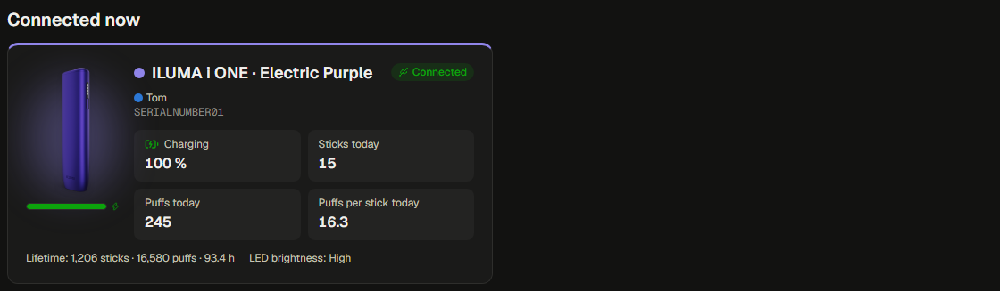

Every device of that person that is plugged into a PC with the agent right
now: the product render with a live battery bar (a bolt while charging),
battery state, sticks today, puffs today and puffs per stick today;
underneath the lifetime counters, usage hours and LED brightness. A running
archive transfer shows progress, percentage and the estimated time left.
Click the card to open the device page.

### This week

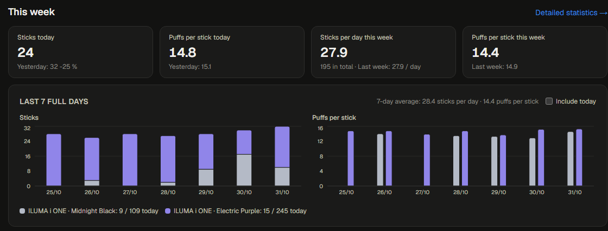

Sticks today (with yesterday), puffs per stick today, sticks per day this
week (with the total and last week) and puffs per stick this week.

### Last 7 full days

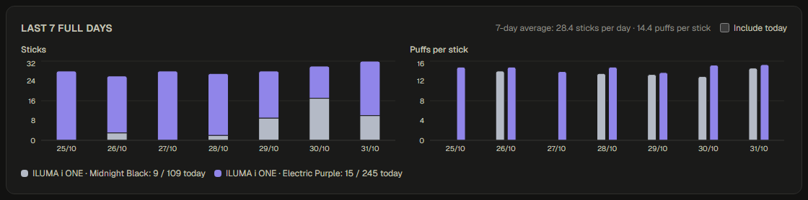

Sticks per day and puffs per stick for the last seven completed days, per
device. The *Include today* switch adds the running day; the card then says
*Last 7 days*. Today is left out by default because it is not over yet, so
the average would be dragged down.

### All devices

The same cards for devices that are not connected. Battery, charging and
brightness are not shown while a device is away because they change in the
meantime; the card shows when the device was last connected instead.

The header shows the connected devices as chips with battery and charging
state, a transfer indicator while records are being read, the theme switch
(system / light / dark) and the language.

## Statistics (`/stats`)

### Choosing the time

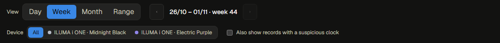

**View** decides how you look at time:

- **Day**, **Week**, **Month** are calendar periods. The arrows page
  backwards and forwards (never into the future) and *Today* jumps back. Day
  runs from midnight to midnight and charts by hour; week starts on the day
  set in *Settings → Display*; month is the calendar month. Clicking a day in
  the week or month view opens that day; clicking an hour in the day view
  lists the records of that hour.
- **Range** is any span: presets (7 days, 30 days, 3 months, 1 year, all) or
  custom dates, with your own grouping by day, week or month. Clicking a bar
  zooms one level finer; *Back* returns.

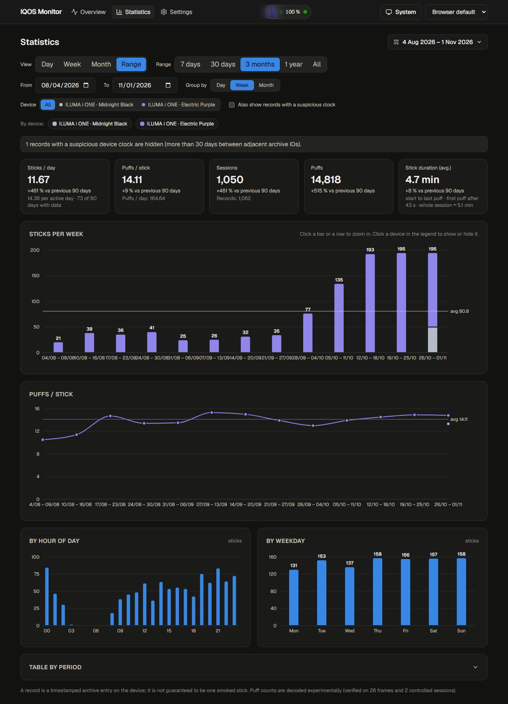

**Who**: the person and the device, as buttons. The legend under the
filters hides a device from the charts with one click and filters to it
with a double click. *Also show records with a suspicious clock* includes
records whose device clock looks wrong (see the last chapter); they are
hidden by default and the page says how many.

### The numbers

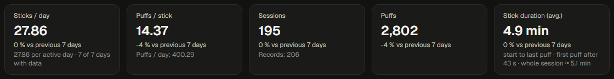

Always for the chosen period: sticks per day, puffs per stick, sticks,
puffs and the average stick duration (from the start of heating to the last
puff), each with the change against the previous period of the same length
and one line of context: per active day and days with data, puffs per day,
record count, first puff after N seconds and the whole session length.

### The charts

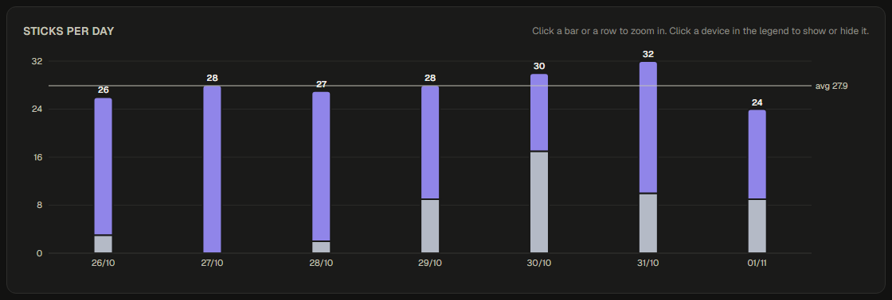

Sticks per day, week or month stacked by device with the average line and a
value on every column that is wide enough; puffs per stick as lines per
device with the overall average. Hover for the exact values of every device
at that point; click to zoom or to list records.

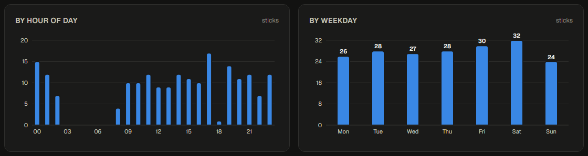

Sticks by hour of the day and by weekday: counts for the period, the per-day
figure in the tooltip, so you see when during the day and on which days you
smoke. In the day view these two are not shown because the main chart
already is by hour.

### Table by period

Collapsed at the bottom: sticks, puffs, puffs per stick, duration, sticks
per day and the raw record count per bucket. A row opens the same
drill-down as the chart.

## Device page (`/devices/<serial>`)

### Header and diagnostics

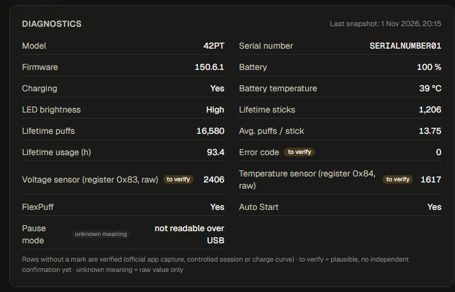

The header shows the render, the name (model and finish unless you named
it), the owner, the connection state and a warning when the archive contains
a clock jump. Diagnostics list model, serial, firmware, battery, charging,
temperature, LED brightness, lifetime sticks (heating starts), puffs, average
puffs per stick, usage hours, the error code and the two raw sensors. Rows
without a mark are verified; *to verify* and *unknown meaning* say what is
still open, and the tooltip on the mark explains why. Live values are shown
only while the device is connected.

### Archive

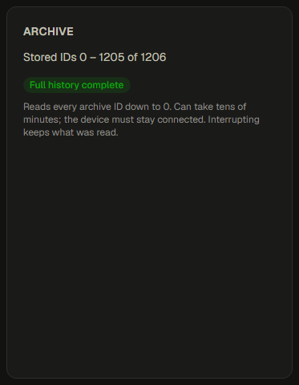

Which archive ids the server holds and the *Download full history* button.
The agent reads every id down to zero in the background while the device
stays connected; the card shows progress, percentage and time left, the
download can be cancelled, and unplugging pauses it until the next
connection. Deleted records come back with a full download, blocked ones
never.

### Device settings

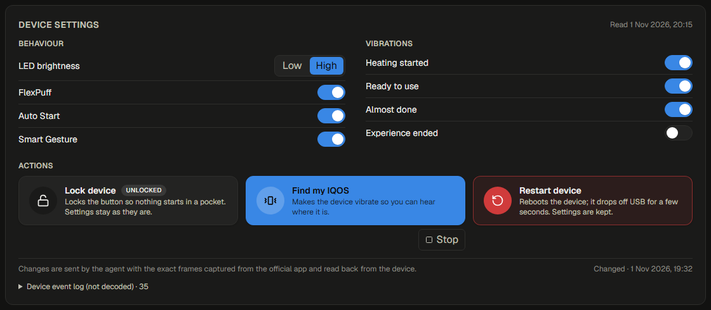

Only while the device is connected: LED brightness (low / high), FlexPuff,
AutoStart, Smart Gesture and the four vibration events as switches.
*Lock device* / *Unlock device* shows the current state, *Find my IQOS*
makes the device vibrate until *Stop*, *Restart device* asks first and drops
the device off USB for a few seconds. Each change is sent by the agent, read
back from the device and reported underneath. The device's raw event log is
folded at the bottom.

### Faulty records

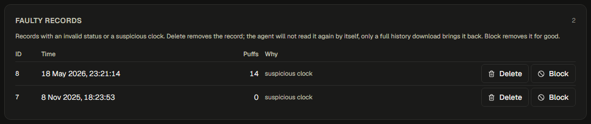

Records with an invalid status (empty read, timeout, CRC error) or a
suspicious clock. *Delete* removes the record; the agent does not read it
again by itself, only a full history download brings it back. *Block*
removes it for good. Removed ids are listed below with *Restore*.

### Archive records and live changes

Every record with time, puffs, time to the last puff and status; *Show
invalid records* adds the empty reads, timeouts and CRC errors. *Live
changes* lists the last live samples: battery, charging and counters
whenever they changed.

## Settings (`/settings`)

### People and devices

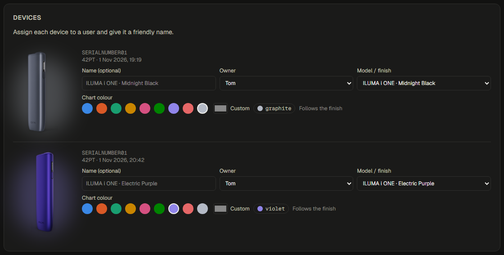

People are added, renamed, recoloured and deleted here; a person groups
devices on the overview and in the statistics filters. For every device you
set the owner, an optional name, the model and finish (which picks the
render) and the chart colour; *Reset* returns the colour to the finish's
default and the page warns when a colour reads badly in one of the themes.

### Agents

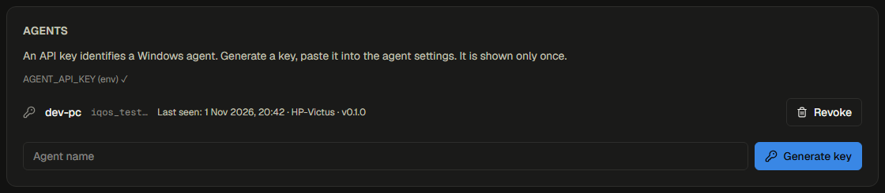

Generate API keys for agents (shown once), see when each agent last reported,
from which PC and with which version. A fixed `AGENT_API_KEY` in the
container environment is accepted as well.

### Display and language

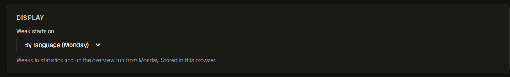

The day the week starts on (by language, Monday, Saturday or Sunday) and the
language (browser default, English, Czech). Both are stored in the browser,
so every person can choose their own.

## The agent (Windows tray)

The tray icon is grey without a device, green with a device connected, blue
during a transfer and red when the server is unreachable. Its menu shows the
devices with battery and transfer state, opens the web app, opens *Settings*
(server address, API key, agent name, language, automatic updates), checks
for updates on demand and toggles *Start with Windows*. The first start opens
the settings window with a *Test* button.

The agent accepts any IQOS over USB. On connect it takes a diagnostics
snapshot, reads the archive records the server lacks (the last three months
on first contact) and streams the live state once a second; while the device
stays plugged in it checks for new records every five seconds. Jobs from the
web (full history download, setting changes) run in the background. The
agent stores nothing on the PC apart from its settings and a log.

With automatic updates on, the agent checks the latest GitHub release once a
day and installs it by itself: download, size and digest check, file swap,
restart. The tray menu's *Check for updates…* does the same immediately.

## When the device's clock is wrong

The IQOS keeps its own clock and stamps every archive record with it at the
moment the stick is inserted. Only the official IQOS app sets that clock
(over Bluetooth, when the device is paired and the app runs). IQOS Monitor
reads the clock but never sets it, because no capture of the official app
setting it exists yet.

What goes wrong: after a reset, a completely drained battery or a long time
without the official app, the clock restarts or drifts. Records then carry
the wrong date and time: a stick smoked today may look like it was smoked in
May, or like it was smoked in 2010. Nothing in the record says which time is
right, so IQOS Monitor cannot correct it afterwards.

What IQOS Monitor does about it:

- Neighbouring archive ids whose times are more than 30 days apart are
  marked as **suspicious clock**. The device page shows the warning in its
  header, the records carry a ⚠ in the tables.
- Suspicious records are **left out of the statistics and the overview** by
  default, so they do not land on the wrong days. *Also show records with a
  suspicious clock* on the statistics page brings them back for a look; a
  notice says how many are hidden.
- They are listed under **Faulty records** on the device page, where you
  can delete or block them if you know they are wrong.

What you can do:

- Connect the device to the official IQOS app now and then; it sets the
  clock. After a reset or a fully drained battery do it before the next
  stick, so the records are stamped correctly from the start.
- Records made while the clock was wrong stay wrong. If their times are
  plainly impossible, block them on the device page; if you only want them
  out of the statistics, leaving them marked is enough.
- The *Live changes* and the live counters are not affected: they are
  stamped by the server when the agent reads them.
